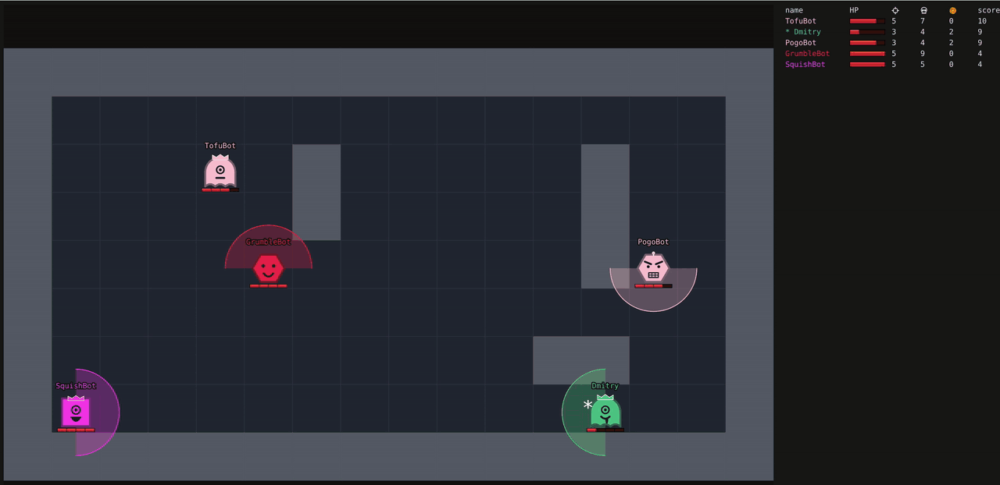

# BOTSCRIPT Arena



A programming battle for one shared screen. Players don't steer anything: each one writes a small program for a bot,
and the bots fight it out on an office TV. Most programs are expected to come from an AI, and the game is built for
that.

Bots **scan, think, act**. The TV draws every scan as an x-ray, so the room can work out each program by watching it
play.

## How it plays

- A grid room with walls, up to 50 players, empty seats filled by house bots. Free-for-all.
- One action per beat (1 s by default). All bots decide on the same snapshot, then the beat resolves.
- Actions: `move`, `scan`, `fire`, `wait`. No facing - every action names its direction.
- A scan covers a cone up to the walls and reports `enemy`, `coin`, `bullet` as levels 0-3 (how lined up they are),
  with no distance. Walls block the view.
- Bullets fly 3 cells per beat, so a target that sees one coming can step aside. Reload is 3 beats. Shots are audible.
- Coins give +1 score, +1 HP and a bonus shot. Kills give +3.
- Thinking is free; slow code (over 100000 ops per beat) misses beats.
- Saving a new program takes the bot off the map for 10 s, so nobody can puppeteer a bot with live edits.

Full rules: [VISION.md](VISION.md). Language: [LANGUAGE.md](LANGUAGE.md).

## The language

BOTSCRIPT is a tiny JavaScript. Memory is 8 number cells `num[0..7]`, 8 place cells `pin[0..7]` and a read-only trail
of the last 3 beats.

```js
function loop() {
  scan(num[0]);                       // look one way
  if (enemy == 3) { fire(num[0]); return; }
  if (chance(20)) num[0] = pick(N, E, S, W);   // sometimes change course
  move(num[0]);
}

function onHit(from) { move(left(from)); }   // got shot: sidestep
```

A bigger example: [examples/magpie.js](examples/magpie.js), a coin collector that avoids fights.

Joining from a phone gives you a working template bot. The "Copy rulebook for AI" button exports the grammar, rules
and example bots for a chat assistant, and `/api/check` lets the AI test a program against house bots before you
paste it.

## Run it

Needs Go 1.26 and Node 22.

```sh
cd arena
make run                     # builds the web app, serves on :8080
ARENA_ADMIN_PASSWORD=secret make run   # also enables the /admin page
```

Open `http://localhost:8080` on the TV and join from phones on the same network.

With Docker:

```sh
cd arena
make docker                  # scratch image, under 20 MB
make docker-run PORT=8080    # data persists in the arena-data volume
```

Server flags, the admin page, the program-check API and deployment behind a reverse proxy:
[arena/README.md](arena/README.md).

## Development

```sh
cd arena
make check                   # lint, tests, coverage/CRAP gate, determinism, generated code, web tests
```

| Path | What |
|---|---|
| `arena/engine` | Go server: deterministic simulation, BOTSCRIPT interpreter, HTTP/WebSocket API |
| `arena/web` | TypeScript client: the TV view, the phone editor, admin |
| `arena/PLAN.md` | Architecture and development rules |
| `arena/TUNING.md` | Simulation runs used to tune the numbers |

The simulation is deterministic: a match replays from its seed, the programs and the edit log.
